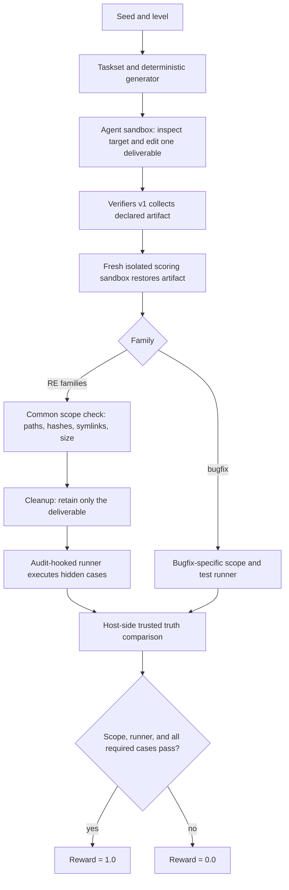

# RLVR Coding Environment

NOTE: work in progress - building more task families and expanding/improving the existing ones


An on-demand, seed-generated RLVR task suite for coding agents. Its main track is
defensive reverse engineering: implement Python behavior from generated key checkers,
compiled programs, and binary formats, each with levels L0–L4. A Python bug-fixing
family provides a calibration and warm-up track. Tasks are execution-graded in
isolated scoring sandboxes, with adversarial QC suites for grader attacks. Instances
are generated from seeds rather than drawn from a fixed benchmark corpus, supporting
contamination-resistant and effectively unbounded evaluation; the current template
variation is intentionally modest and is not a guarantee against memorization.

## Task families

| Family | What the agent gets | Deliverable | Level progression |
| --- | --- | --- | --- |
| **bugfix** | A generated Python module and visible tests | `lib.py` | L1: one buggy function and a visible failing test. L2: two buggy functions from different templates; visible tests pass, while hidden tests cover both. |
| **keygen** | A generated license checker and one example name/serial | `keygen.py` | L0: readable Python checker. L1: C source and an `-O0` binary. L2: symbol-rich `-O0` binary only. L3: stripped `-O2` binary. L4: L3 plus XOR-encoded constants. L5: 8 per-op `noinline` functions behind a function-pointer table. L6: op sequence compiled to bytecode run by an embedded interpreter. |
| **decompile** | A generated program that maps lists of uint32 values to a uint32 result, plus one example | `solution.py` | L0: C source and an `-O0` binary. L1: symbol-rich `-O0` binary only. L2: stripped `-O2` binary. L3: generated control-flow flattening. L4: L3 plus opaque predicates and XOR-encoded constants. L5: 8 stages as separate `noinline` functions called through a pointer table, keeping L4 protections. L6: stages compiled to bytecode run by an embedded interpreter with per-seed opcodes. |
| **formats** | A generated binary reader and two valid sample files | `parser.py` | L0: C source and an `-O0` reader with fixed-width little-endian fields. L1: symbol-rich `-O0` binary; adds per-field endianness and ASCII strings. L2: stripped `-O2` reader with a checksum. L3: adds ULEB128 and flag-gated optional fields. L4: rolling-XOR-obfuscated record payload plus flattened control flow and encoded constants. |

All three reverse-engineering families generate 50 hidden cases per task. Formats
uses 38 valid and 12 invalid files. Bugfix generates 50 hidden cases per function.

## Architecture

**Verifiers v1** supplies the taskset/task lifecycle, Docker runtime integration,
artifact collection and isolated scoring. This repository supplies deterministic
family generators, task setup and prompts, trusted references, grading logic, and
attack suites. Keygen, decompile, and formats share the isolated function runner and
host-side comparison; bugfix uses its family-specific test runner.



For the reverse-engineering families, the common scope check requires the expected
files, matching protected hashes, no symlinks or non-regular files, and a 16 KiB
deliverable limit. Extra regular files are allowed at scope check but removed before
the shared runner imports candidate code. Bugfix uses its own stricter file-set and
scope checks and visible/hidden test flow rather than that cleanup and audit hook.

## Security model: why this is hard to cheat

The QC counts below are expected checks in the repository's attack scripts; a passing
suite is targeted evidence, not a proof of security.

| Family | QC coverage | Attacks exercised and defenses |
| --- | --- | --- |
| **bugfix** | 26 expected checks per run at L1 and L2 | Forged results and visible-test edits are checked against protected files and host-computed hidden truth. Exact file/symlink checks, timeouts, and malformed/import failure handling cover scope and execution attacks. |
| **keygen** | 56 checks across L0/L3 and two seeds | Checker-oracle and embedded-checker attacks meet cleanup before grading and the shared audit hook. Required-file checks, protected hashes, host-side truth, nonce-bound results, type checks, and timeout handling cover other attacks. |
| **decompile** | 68 checks across L0/L3 and two seeds | Includes binary wrapping, ctypes/mmap execution, and hook-rewrite attacks. The shared audit hook denies native execution paths; host truth, required-file checks, and timeouts address the other attacks. |
| **formats** | 64 checks across L0/L3 and two seeds | Includes reader-oracle, embedded-reader, native-execution, sample-hardcoding, and valid-only attacks. Hidden valid and invalid files, strict JSON return validation, host truth, required-file checks, and binary reward defeat these shortcuts. |

The shared runner rejects subprocess/process creation, ctypes and mmap execution paths,
`/proc` opens, and attempts to rewrite the audit hook. It treats exceptions and invalid
return types as failed cases. Trusted references compute expected results outside the
submission; a nonce-bound result file does not let a submission choose the truth.

**Residual risks:** the attack lists are finite and do not establish complete isolation.
The task containers request `NetworkPolicyConfig(allow=[])`; the documented network
probe checks that route, not every possible route. Candidate code can read the grader
cases and nonce, but host-side truth comparison still applies. Emulating a disclosed
checker/program in Python is legitimate reverse-engineering work, not a grader hack.
Bugfix currently has six templates and limited mutations, so memorization remains a
risk; held-out splits are planned.

## Reward design

Rewards are binary. A submission earns `1.0` only when scope is valid, grading
completes, and every required hidden case matches trusted output; otherwise it earns
`0.0`. Formats requires all valid and invalid cases to pass. Its
`valid_pass_frac` and `invalid_pass_frac` are diagnostic metrics, not partial reward.

Diagnostic metrics include `scope_ok`, `hidden_pass_frac`, `runner_timeout`, and
family-specific `visible_pass`, `example_ok`, `valid_pass_frac`, and
`invalid_pass_frac`. The reverse-engineering runner enforces exact output types:
strings for keygen, uint32 integers (not booleans) for decompile, and JSON objects or
`None` with only JSON-compatible values for formats.

Grading fails closed on scope violations, import/runtime exceptions, invalid outputs,
timeouts, missing or malformed results, nonce mismatches, and incomplete case lists.
Provider/API errors occur outside the grader and should be tracked separately from
agent submissions that execute but fail tests.

## Quickstart

From the repository root:

```bash
uv sync
docker build -f docker/keygen.Dockerfile -t rlvr-keygen:0.1 .
```

The reverse-engineering families reuse that local image; bugfix uses its Python task
image. Validate all levels with the Docker runtime:

```bash
for family in keygen decompile formats; do
  for level in 0 1 2 3 4; do
    uv run vf-validate "$family" --runtime.type docker --taskset.level "$level" -n 3
  done
done
for level in 1 2; do
  uv run vf-validate bugfix --runtime.type docker --taskset.level "$level" -n 3
done
uv run vf-validate keygen --runtime.type docker --taskset.level 0 \
  --taskset.split eval -n 3
```

Run the grader-attack suites:

```bash
uv run python qc/run_attacks.py
uv run python qc/run_attacks.py --level 2
uv run python qc/run_keygen_attacks.py
uv run python qc/run_decompile_attacks.py
uv run python qc/run_formats_attacks.py
```

Render rollout transcripts from `outputs/*/traces.jsonl` to a single self-contained
HTML file (sidebar of rollouts, rewards, grading info, messages and submitted
artifacts):

```bash
uv run python tools/view_transcripts.py outputs --open
```

Example rollouts (configure the named API-key variables through your usual secret
manager; do not put keys in the command line). Set `LITELLM_GEMINI_MODEL` to a model
alias configured in your local LiteLLM proxy:

```bash
uv run vf-run bugfix -n 2 -r 1 -c 1 -m "$LITELLM_GEMINI_MODEL" \
  --client.base-url http://localhost:4000/v1 \
  --client.api-key-var GEMINI_API_KEY \
  --env.agent.runtime.type docker
```

For a local Ollama model:

```bash
uv run vf-run bugfix -n 2 -r 1 -c 1 -m qwen3:1.7b \
  --client.base-url http://localhost:11434/v1 \
  --client.api-key-var OLLAMA_KEY \
  --env.agent.runtime.type docker
```

## Baselines

| Family/level | deepseek-flash (0.3) | qwen3:1.7b (0.3) |
| --- | --- | --- |
| keygen L0 | 10/10 | 0/5 |
| keygen L2 | 10/10 | 0/5 |
| keygen L4 | 10/10 | n/a |
| keygen L5 | 10/10 | n/a |
| keygen L6 | 10/10 | n/a |
| decompile L0 | 10/10 | 0/5 |
| decompile L2 | 10/10 | 0/5 |
| decompile L4 | 10/10 | n/a |
| decompile L5 | 10/10 | n/a |
| decompile L6 | 10/10 | n/a |
| formats L0 | 10/10 | 0/4 |
| formats L2 | 10/10 | n/a |
| formats L4 | 9/10 | n/a |

deepseek-flash on generator 0.3 (N=10/cell, train seeds 0-9, max-turns 30):
129/130 solved; the one miss was a max-turns stop on formats L4
(`baselines/results_v0.3.json`; 0.2 results in `baselines/results_v0.2.json`).
qwen3:1.7b via Ollama (num_ctx 16384, Q4_K_M, ~2-6 min/episode) solved 0 episodes
across 5 cells (N=5; formats L0 partial at 4/5 recorded — one episode was killed
at ~3h CPU wall). Its failures reached grading (scope_ok=1) with wrong outputs,
but sampled traces show it often fails to use the `edit` tool (non-matching
`old_str`) and rarely reads files or uses bash, so read these cells as a
tool-use floor for a 1.7B model, not a measure of reverse-engineering ability.
Provider/harness errors are excluded from
solved/attempted denominators; at these N the Wilson intervals are wide.

### Evaluation protocol

- **(a) Seed held-out:** train with `--taskset.split train` and report on
  `--taskset.split eval`; this seed split is implemented in code.
- **(b) Level held-out:** train on L0–L2 and evaluate on L3–L4 by selecting CLI levels.
- **(c) Family held-out:** train on keygen and decompile, then evaluate on formats by
  selecting task families.

Only seed-held-out evaluation has a dedicated code split; level and family holdouts
are experiment choices made through the existing CLI.

## Scope and responsible use

Targets are generated by this project; the tasksets do not ask agents to inspect
third-party or closed-source software. Sandboxes are configured without network
allow-lists. Deliverables are analysis-oriented Python implementations of generated
behavior—not exploits, shellcode, evasion, or packing. Use reverse-engineering
techniques only on targets you own or are authorized to analyze. This section is not
legal advice.

Any task family based on real code must use code the operator is
authorized to provide and process, with appropriate data handling and approval.

## RL glossary

- **RLVR:** reinforcement learning with rewards computed by verifiable task outcomes.
- **Rollout:** one sampled agent trajectory through a task and its tool interactions.
- **Verifier:** code that evaluates a completed trajectory and emits reward/metrics.
- **Reward hacking:** exploiting a verifier shortcut rather than satisfying the task.
- **GRPO:** Group Relative Policy Optimization, which updates a policy using relative
  rewards among sampled completions for a prompt.
- **pass@k:** estimated chance that at least one of `k` sampled attempts solves a task.
- **Held-out split:** seeds or templates reserved from training for evaluation.
- **Learnable band:** task difficulty where a model sometimes succeeds and sometimes
  fails, providing a useful learning signal.

## Roadmap

- Establish per-level baselines across the task families.
- [x] Add held-out seed splits for stronger generalization measurement.
- Run a small GRPO + LoRA experiment on a free GPU.
- Add a true black-box level after non-root sandbox support is verified.

## Design notes

See [`docs/DESIGN.md`](docs/DESIGN.md) for the major design decisions and trade-offs.

## Credits and license

This project uses [Verifiers v1](https://github.com/PrimeIntellect-ai/verifiers) by
Prime Intellect. This repository is MIT-licensed; see [`LICENSE`](LICENSE).
